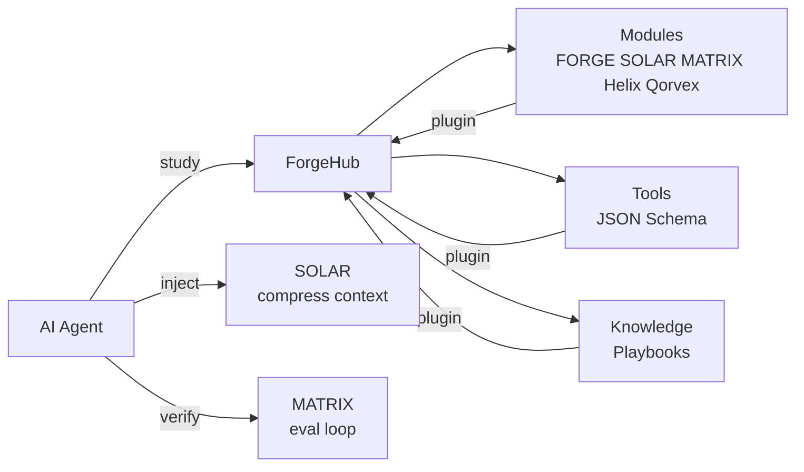

<div align="center">

  

# 🔧 ForgeHub

### The master workshop for AI agents

**Study it. Then use the right tool.**

[](https://www.python.org/)
[](LICENSE)
[](#tests)
[](#modules)
[](#knowledge)
[](#tools)
[](#architecture)

</div>

---

## What is ForgeHub?

ForgeHub is a **knowledge and tool registry for AI agents**. It is the "master
workshop" where an AI studies instructions, discovers tools, and learns which
module to use for which task.

> "Study the workshop, then use the right tool."

ForgeHub ties together the FORGE ecosystem:

| Module | Purpose | When to use |
|---|---|---|
| **FORGE** | Code quality & verification | Scan, audit, SBOM, policy enforcement |
| **SOLAR** | Token optimization | Compress, cache, route, budget |
| **MATRIX** | AI learning environment | Tasks, eval, memory, tool registry |
| **Helix** | SOC observability | Events, TSDB, alerting, dashboards |
| **Qorvex** | Code verification | SAST/DAST, sandbox, SBOM, reports |

## Architecture



### Plugin architecture

Everything is a plugin. Adding a new capability = adding a file. No core code
changes needed.

```
forgehub/
├── modules/          # one .py file per module (defines MODULE object)
├── (core)            # registry, search, inject, cli
knowledge/            # playbook .md files with YAML frontmatter
tools/                # tool schema .json files
```

To add a new module (e.g. "ApexGuard"):
1. Create `forgehub/modules/apexguard.py` with `MODULE = Module(...)`.
2. Add `tools/apexguard.<tool>.json`.
3. Add `knowledge/<topic>.md`.
4. Restart ForgeHub — auto-discovered.

## Quick Start

```bash
pip install -e .
forgehub list                          # list modules, tools, knowledge
forgehub search "compress token"       # search
forgehub show prompt-compression       # read a playbook
forgehub describe solar                # describe a module
forgehub context                      # print AI context map
forgehub inject "refactor load_config" # build context bundle for a task
```

## AI Context Map

The key feature: `forgehub context` (or `AI_CONTEXT.md`) gives an AI agent a
complete, machine-readable map of the ecosystem:

- What each module does and when to use it
- Available tools with descriptions
- Available playbooks with when/steps/pitfalls
- Rules for AI agents
- How to extend ForgeHub

An AI told "study ForgeHub" reads this and knows exactly which tool to use.

## Playbooks (Knowledge)

| ID | Title | Module |
|---|---|---|
| `prompt-compression` | Compress prompts without breaking code | SOLAR |
| `context-optimization` | Select relevant context within a budget | SOLAR |
| `semantic-cache` | Cache LLM responses by similarity | SOLAR |
| `code-review` | Review code for quality | FORGE |
| `security-scan` | Scan codebase for vulnerabilities | FORGE |
| `code-verification` | Verify AI-generated code | Qorvex |
| `debugging` | Debug systematically | FORGE |
| `testing` | Write effective tests | FORGE |

Each playbook has: when, steps, tools, pitfalls, verify, provenance (source, date, confidence, TTL).

## Modules

| ID | Name | Status | Tagline |
|---|---|---|---|
| `forge` | FORGE | active | Code quality and verification platform |
| `solar` | SOLAR | active | Token optimization layer |
| `matrix` | MATRIX | planned | AI work environment |
| `helix` | Helix | beta | SOC observability platform |
| `qorvex` | Qorvex | active | AI code verification |

## Tests

```bash
python -m pytest tests -q
```

## Honest limitations

- This is a **registry**, not a brain. It doesn't make models smarter; it gives
  them structured, curated knowledge to retrieve.
- Semantic search is keyword-based (BM25 optional). Vector search not yet.
- Playbooks are hand-written; auto-generation from successful tasks is planned.
- No GUI yet; CLI only.

## Roadmap

- [ ] Semantic search (embeddings)
- [ ] Auto-generate playbooks from successful tasks (with human review)
- [ ] SOLAR integration in `inject` (compress context)
- [ ] MATRIX eval loop integration (measure if playbooks help)
- [ ] Web UI catalog
- [ ] More modules (ApexGuard, AgentMesh, ...)

## Contributing

Add a module by dropping a file in `forgehub/modules/`. See
[AI_CONTEXT.md](AI_CONTEXT.md) for the format.

## License

MIT

<div align="center">
  
</div>
